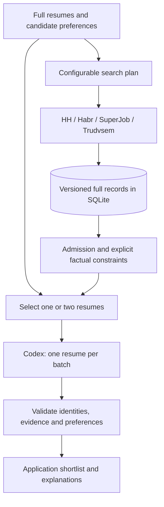

# Career Scout

**Resume-driven job discovery with durable collection and evidence-backed review.**

`0.1.0 alpha` · `Python 3.12` · `SQLite` · `JSON CLI` · `MIT implementation`

[Back to selected work](../../README.md)

Career Scout turns overlapping job-board results into a personal application
shortlist. It collects complete vacancies from four Russian platforms, preserves
them locally and evaluates them against full resumes and candidate preferences.
It is a working personal alpha. The implementation repository is currently private;
this page is a public case study, not a downloadable release or hosted demo.

## The problem

A candidate may pursue several kinds of work with different resumes. Titles are
inconsistent, listings overlap, pay is often missing and keywords alone do not
show whether the actual work fits the person's experience. Re-reading the same
results adds work without improving the decision.

I designed and built a pipeline that separates reliable data collection from
personalized semantic assessment. Development used Codex assistance; validation
combines deterministic checks, synthetic scenarios and bounded live runs.

## The system

### Collection that survives interruption

Pagination, source identifiers, publication windows, retries and checkpoints are
code. Full records and source versions live in SQLite. A later collection reads
listings again and downloads full descriptions only for new IDs. An unavailable
source remains an observable collection problem, not a reason to reject a candidate.

### Personalization without a fixed profession list

The agent-facing CLI accepts arbitrary resume IDs, full texts, goals and preferences.
Contexts are versioned; old decisions are not presented as evaluations under new
requirements. An external Decisions connector routes multi-resume cases to one or
two evaluators. A single resume needs no routing call when automatic exclusion is off.

### Model reasoning with explicit limits

Codex runs through the user's subscription, with one complete resume and up to
20 independent vacancies per batch, across at most four slots. Code owns budgets,
queue progression and persisted results. No LLM orchestrator is needed to distribute
jobs or combine JSON.

PASS, UNCERTAIN and REJECT remain distinct. Result validation checks evidence
references, source identity and coverage of candidate preferences. Missing salary
is not zero; an unmentioned skill is not a proven contradiction. A valid quotation
still does not prove that the model interpreted it correctly.

## What was verified

| Evidence | Observed result | Limit |
|---|---|---|
| Earlier owner-specific workflow | A frozen catalog of 9,385 vacancies completed; 985 unique LLM evaluations | Earlier workflow, not a rerun through the new generic context |
| 0.1 offline acceptance | 484 passing tests, package builds and Docker data persistence | Execution and contracts, not semantic accuracy |
| Installed-package scenario | Collection/resume/new through evaluation, shortlist and history | Explicit HTTP and Codex simulators |
| Bounded live source probes | Search and full details succeeded on all four platforms | Eight HTTP attempts, a point-in-time access check |
| Live generic model check | Four synthetic vacancies, two resumes; three labels matched | Too small to estimate general quality |

The audit found and fixed a nested SQLite transaction at the collection-to-analysis
boundary and partial history writes on a late event-ID conflict. Previously saved
working evaluations were preserved.

## What makes it reusable

Resumes, queries, conditions, source selection, batch limits and executors are
configuration, not a hardcoded set of professions. An agent can discover the JSON
schema and operate the CLI without writing SQL. Full source records and explanations
make later review possible; request IDs and saved budgets support recovery.

## Current boundaries

The multi-resume Decisions helper is not distributed with the package yet, and
Codex must be installed and authenticated separately on the host. Habr uses frontend
JSON/HTML rather than a confirmed public search API. Broad semantic accuracy still
needs held-out labels across candidates. Probability-based automatic exclusion is
off by default. There are no automatic applications or schedules.

The next validation steps are an external Linux installation, a distributable
routing connector and measurement of false rejections on a broader control set.
The project is deliberately versioned as an alpha, not a stable 1.x service.

---

Designed and built by [Tim Smykov](https://github.com/timsmykov).
This case contains no real resumes, vacancy descriptions, credentials or working databases.
